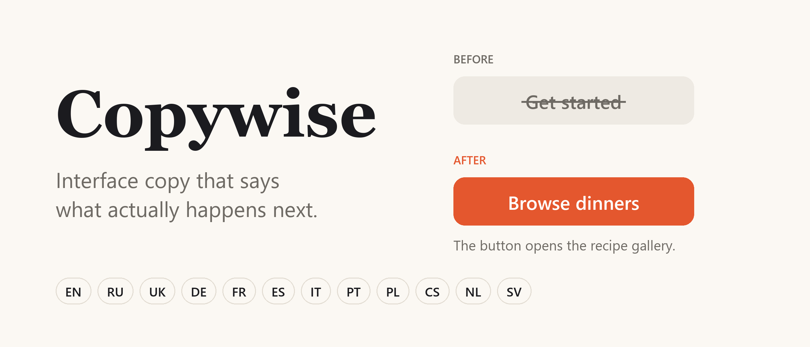

<p align="center">
  
</p>

<p align="center">
  <b>A UX writing skill for coding agents.</b><br>
  Copywise reads what a button actually does, then writes the words people see in your interface.<br>
  English, Russian, Ukrainian, and nine more European languages.
</p>

<p align="center">
  <a href="LICENSE"></a>
  <a href="https://agentskills.io"></a>
  <a href="#install"></a>
  <a href="https://github.com/fullmamasha/copywise/stargazers"></a>
</p>

<p align="center">
  <a href="#install">Install</a>&nbsp;&nbsp;&nbsp;
  <a href="#see-the-difference">See the difference</a>&nbsp;&nbsp;&nbsp;
  <a href="#use-it">Use it</a>&nbsp;&nbsp;&nbsp;
  <a href="#the-agent-doesnt-see-copywise">Troubleshooting</a>
</p>

---

Agents write interface text the way they write everything else: “Get started”, “Something went wrong”, “Unlock powerful collaboration”. The words sound fine and tell the person nothing. Copywise gives your agent the habits of a product writer:

- **It reads the code before naming a button.** If the handler opens a review screen, the label says “Review order”. If it charges the card, it says so and shows the amount.
- **It refuses to invent facts.** A network timeout is not a failed payment. A send request is not a delivered email. No fake countdowns, no made-up “3× more leads”.
- **It writes natively in the interface language.** Form of address, the reader’s unknown gender, plural forms, case in variables, and each language’s typography, instead of an English draft translated line by line.

## See the difference

| Situation | Typical agent draft | With Copywise |
| --- | --- | --- |
| The button opens the recipe gallery | Get started | Browse dinners |
| A payment request timed out and the charge is unknown | Something went wrong. Please try again. | We couldn’t confirm your payment. **Check payment status** |
| Russian app on «ты», the reader’s gender is unknown | Ты сохранил рецепт! | Рецепт в избранном |
| Ukrainian greeting with a `{name}` variable | Вітаємо, {name}! *(renders “Вітаємо, Олександр!”, the wrong case)* | Вітаємо! Ви увійшли як {name} |
| German shop on Sie, the button places a paid order | Weiter | Zahlungspflichtig bestellen |
| Polish file app, the reader’s gender is unknown | Przesłałeś pliki | Przesłano pliki |
| Ukrainian plural copied from English rules | `one {# файл} other {# файлів}` *(renders “2 файлів”)* | `one`, `few`, `many`, and `other`, each with the right form |

## Install

| Your agent | Fastest route |
| --- | --- |
| Claude Code | `/plugin install copywise --marketplace fullmamasha/copywise` |
| Codex | `$skill-installer install https://github.com/fullmamasha/copywise/tree/main/skills/copywise` |
| Cursor, GitHub Copilot, Gemini CLI, OpenCode, Windsurf, and others | `npx skills@1.9.0 add fullmamasha/copywise --skill copywise -g -y --copy` |
| Claude.ai and Claude Desktop | Upload [copywise.zip](https://github.com/fullmamasha/copywise/releases/latest/download/copywise.zip) in **Customize → Skills** |

<details>
<summary><b>Claude Code</b></summary>

Run this inside Claude Code 2.1.275 or later:

```text
/plugin install copywise --marketplace fullmamasha/copywise
```

On an older version, add the marketplace first:

```text
/plugin marketplace add fullmamasha/copywise
/plugin install copywise@copywise
```

Claude uses the skill on its own when you build or edit interface text. To call it directly, type `/copywise:copywise`. Plugin skills always carry the plugin name as a prefix.

</details>

<details>
<summary><b>Codex</b></summary>

Type this in a Codex session:

```text
$skill-installer install https://github.com/fullmamasha/copywise/tree/main/skills/copywise
```

The installer puts the skill in `~/.codex/skills/copywise`. Start a new session if Codex does not list it right away.

</details>

<details>
<summary><b>Cursor, GitHub Copilot, Gemini CLI, OpenCode, Windsurf, and other agents</b></summary>

With Node.js 22.20 or later:

```sh
npx skills@1.9.0 add fullmamasha/copywise --skill copywise -g -y --copy
```

`-g` installs the skill for your user, so every project sees it. Without `-g`, the skill lands only in the folder where you ran the command. `--copy` writes real files instead of links, which avoids link problems on Windows. The command also covers Claude Code and Codex if they are installed.

Gemini CLI can also install from GitHub directly:

```sh
gemini skills install https://github.com/fullmamasha/copywise.git --path skills/copywise
```

</details>

<details>
<summary><b>Claude.ai and Claude Desktop</b></summary>

1. Download [copywise.zip](https://github.com/fullmamasha/copywise/releases/latest/download/copywise.zip) from the latest release.
2. Open **Customize → Skills**, choose **+**, then **Upload a skill**.
3. Select the ZIP and turn Copywise on.

</details>

<details>
<summary><b>Manual install</b></summary>

Copy the [`skills/copywise`](skills/copywise) folder, not the whole repository, into one of these folders. `SKILL.md` must end up directly inside a folder named `copywise`.

| Agent | For all your projects | For one project |
| --- | --- | --- |
| Claude Code | `~/.claude/skills/copywise` | `.claude/skills/copywise` |
| Codex | `~/.agents/skills/copywise` | `.agents/skills/copywise` |
| Cursor | `~/.cursor/skills/copywise` | `.cursor/skills/copywise` |
| GitHub Copilot in VS Code | `~/.copilot/skills/copywise` | `.github/skills/copywise` |
| Gemini CLI | `~/.gemini/skills/copywise` | `.gemini/skills/copywise` |
| OpenCode | `~/.config/opencode/skills/copywise` | `.opencode/skills/copywise` |

Cursor, Copilot, Gemini CLI, and OpenCode also read `.agents/skills`, so one copy there serves all of them. Claude Code does not read `.agents/skills`.

If your agent has no skill support, add this to its instructions with the real path: *Before writing interface text, read `path/to/copywise/SKILL.md` and follow it.*

</details>

## Use it

Copywise starts on its own when the agent writes or edits text people see in a product. To make that dependable on feature work, add one line to your project instructions (`CLAUDE.md`, `AGENTS.md`, or your agent’s rules file):

> Use Copywise whenever you create or change text that a person sees in the interface.

Then give it a real task. Name the voice or the interface language when it differs from the project.

**Build from an idea**

> Build a saved-recipes screen for a cooking app. The first recipe is saved from the recipe browser. Use Copywise. Keep it playful and write the interface in Russian.

**Edit a real flow**

> Use Copywise to review our checkout. Trace both buttons on the review screen. Rewrite anything that leaves shoppers unsure when they will be charged. Keep the existing locale keys.

**Audit a locale file**

> Використай Copywise. Перевір locales/uk.json і виправ рядки, що звучать неприродно. Ключі та змінні не змінюй.

**Write a landing page**

> Use Copywise for a contractor lead service. Contractors choose trades and ZIP codes. The main action opens a partner application. Use a business voice and only the claims in this brief.

Copywise keeps the product’s existing terms and form of address. Four voice profiles cover playful, modern and youthful, business, and financial products, and a playful product still handles a billing problem plainly. When a fact is missing, it writes the strongest accurate line and lists the open question for you.

## The agent doesn’t see Copywise

1. **Check the folder.** `SKILL.md` must sit at `<skills folder>/copywise/SKILL.md`. Copying the whole repository gives `copywise/skills/copywise/SKILL.md`, which agents do not find.
2. **Check the scope.** Without `-g`, `npx skills add` installs into the folder where you ran it. Run it again with `-g`, or run it from the project you open in the agent.
3. **Check the agent’s folder.** Claude Code reads `.claude/skills` and `~/.claude/skills` only. A copy in `.agents/skills` serves Codex, Cursor, and Gemini but not Claude.
4. **Reload.** Claude Code: `/reload-skills`, or `/reload-plugins` for the plugin. Gemini CLI: `/skills reload`. Codex and Cursor: restart. Copilot: start a new chat.
5. **In Claude Code, look for the prefix.** The plugin version is `/copywise:copywise`, not `/copywise`.

Still stuck? [Open an issue](https://github.com/fullmamasha/copywise/issues) with your agent, its version, and where the files ended up.

## What’s inside

| File | What it covers |
| --- | --- |
| [`SKILL.md`](skills/copywise/SKILL.md) | The workflow: read the product, trace each action, write the screen, review, and deliver |
| [Voice and product categories](skills/copywise/references/voice.md) | Four voice profiles, category defaults, and tone shifts inside one flow |
| [Interface patterns](skills/copywise/references/patterns.md) | Buttons, forms, empty states, errors, dialogs, notifications, consent, cancellation |
| [Conversion writing](skills/copywise/references/conversion.md) | Landing pages, pricing, and checkout without invented claims |
| [Reading, typography, and localization](skills/copywise/references/reading.md) | Layout, accessibility, plurals, currency formats |
| [Russian](skills/copywise/references/russian-product-writing.md) and [Ukrainian](skills/copywise/references/ukrainian-product-writing.md) | Address, gender, case in variables, plurals, typography, and a casebook. The Ukrainian guide also lists common Russian calques |
| [European languages](skills/copywise/references/european-languages.md) | German, French, Spanish, Italian, Portuguese, Polish, Czech, Dutch, and Swedish |

The [research notes](docs/research.md) link each editorial decision to published guidance.

## Tested with evals

The [evals](evals/README.md) folder holds 19 cases with checkable statements, from a payment timeout to Ukrainian calques and French spacing. With Claude Code 2.1.269 or later, run them from the repository root:

```sh
claude plugin eval . --scaffold --allow-tools Write,Edit --runs 1
```

Each run is a billed model call. Narrow it with `--case 'uk-*'`.

## Contributing

The most useful contribution is a string Copywise got wrong. [Open an issue](https://github.com/fullmamasha/copywise/issues) with the brief, what the agent wrote, and what a good line would say. Native speakers who can review a language reference are especially welcome. Changes go through pull requests.

---

<p align="center">
  Made by <a href="https://github.com/fullmamasha">@fullmamasha</a> for designers and developers who care about the words in their products.<br>
  Free under the <a href="LICENSE">MIT License</a>. If Copywise helped, a star helps other people find it.
</p>
